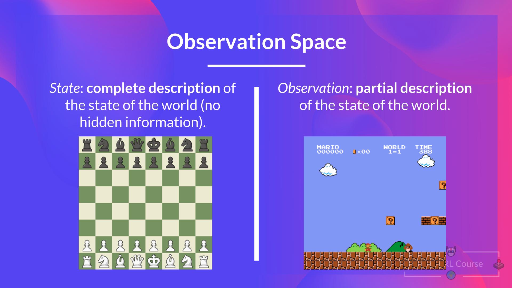
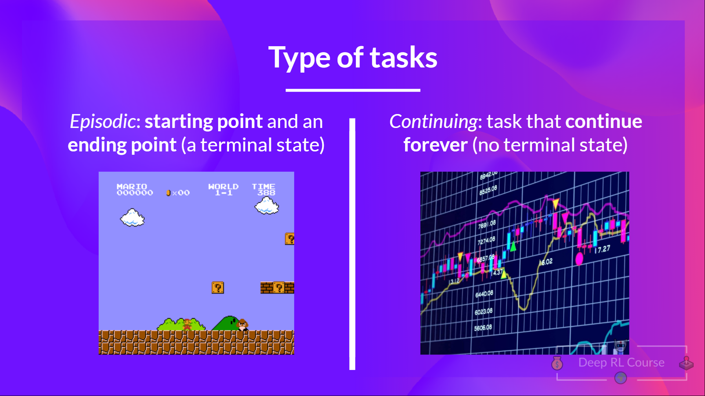

**目标：** 能把任何控制任务写成状态、动作、奖励和折扣回报。

## 接着上回

还记得给一台机器人调 PD 参数让它站稳吗？轮足机器人的控制器就是 $u = -K_p \cdot \text{pitch} - K_d \cdot \text{gyro}$：两个数，手调，调高调低，直到它不倒为止。现在换成一台会走路的机器人，每个关节、每个动作都这么调一遍。没人会这么干。用强化学习让同一台轮足机器人站稳的策略，里面大约有 4600 个数，没有一个是人手敲进去的。

这堵墙早就有人撞过。1957 年，Richard Bellman 把序贯决策问题写成了状态、动作和每一步的收益，并给出了在已知系统规则时的解法。1992 年，Gerald Tesauro 的 TD-Gammon 靠自己和自己下西洋双陆棋学会了这个游戏，只在每盘结束时按输赢拿奖励，最后达到了强手人类棋手的水平。2013 年，DeepMind 的团队（Mnih 等人）用同一个网络，直接从屏幕像素学会了七款 Atari 游戏，唯一的反馈就是游戏分数。

三个完全不同的问题，第一步却一模一样，也是最直白的那一步：不再去写控制器，而是把控制器所在的那个循环写下来。

## 打个比方

给一个小孩一款他从没见过的游戏。没人讲规则。他按按钮，吃金币，撞上敌人死掉，再来一次。一个下午之后，他就玩得很溜了。强化学习的全部想法都在这一幕里：在交互中学，分数是唯一的反馈。

所以最朴素的模型是：多试，留下得分的做法。放到机器人身上，这几乎就成立了。可是看看小孩手里拿到了什么：一块屏幕、一个只有几个键的手柄、角落里的分数。这三样都是有人设计好的。机器人一样都没有。在任何学习开始之前，得先有人决定这个游戏到底是什么。第一天，这个人就是我们自己。

## 一步一步来

### 先把循环走一遍

先用游戏来讲，零件都看得见。

- 智能体（agent）从环境（environment）拿到状态（state）$S_0$：游戏的第一帧。
- 根据 $S_0$，它做出动作（action）$A_0$：往右走。
- 环境进入新状态 $S_1$：新的一帧。
- 环境给回奖励（reward）$R_1$：还没死，$+1$。

一直重复下去，循环就吐出一长串“状态、动作、奖励、下一个状态”：

$$
\tau = (S_0, A_0, R_1, S_1, A_1, R_2, S_2, A_2, R_3, \dots), \qquad A_t \sim \pi(\cdot \mid S_t)
$$

::: tip
$\tau$（tau）是轨迹（trajectory），也就是发生过的一切的录像带。$\pi$ 是策略（policy），智能体的大脑：给它状态，它告诉你做什么动作。注意下标：在 $t$ 时刻行动换来的奖励，是和下一个状态一起到的，所以记作 $R_{t+1}$。
:::

在下面一步步点一遍。策略就是抛硬币，在什么都不懂的时候，我们也只能这样。

<rl-loop gamma="0.9" max-steps="20"></rl-loop>

现在把游戏换成轮足机器人。循环一模一样，只是跑在 100 Hz：每 10 ms，策略读一次状态，发一次动作，收一次奖励。问题来了：这些零件没有一个是机器人自带的。游戏设计师给了小孩屏幕、按键和分数，我们手里只有一个电机驱动和一个 IMU。

### 环境是我们设计的

这听起来像废话，却是我花了最久才接受的一点：强化学习的环境完全由我们决定。智能体能做什么、能看到什么、怎么拿报酬，全是我们定的。

对轮足机器人来说，前两样比较机械：

- **动作：** 两个轮子的电压，各在 $[-1, 1]$ 之间，缩放到 $\pm 8$ V。
- **观测：** 36 个数：IMU、轮速、指令，再加上过去几帧的历史。

有意思的是第三样。最直白的奖励是“每一步没倒就 +1”。问题是，原地站稳和一边站稳一边滚出房间，拿到的奖励一模一样。机器人做的是我们付钱让它做的事，不是我们心里想的事。所以奖励就成了我们的“感知层”：拿能测到的量，加上我们自己对“好”的定义。

```python
tip_pos = pos_err + l_com * sin(pitch)
tip_vel = ground_vel + l_com * pitch_rate * cos(pitch)

r =  1.0 * exp(-(tip_pos / 0.05)**2)      # position bonus
   - 0.1 * abs(tip_vel)                   # damping
   - 1.0 * norm(a - a_prev)**2            # slew
   - 0.3 * (gyro_z - cmd_yaw_rate)**2     # yaw
```

::: tip
正的是“好”，负的是“不好”。唯一的正项要求机器人顶端停在它出发的那个点上方；另外三项分别罚晃动、罚电压猛变、罚没让它转的时候乱转。
:::

::: field
**奖励是唯一的反馈。** 没有标签告诉它哪个电压是对的，每一步只有这一个数。策略行为古怪时，先读奖励，再看网络：它通常正一丝不苟地执行这个函数付钱让它做的事。四项，只有一项是正的，每一项都是一个决定。第 12 天会逐项拆开。
:::

观测定下来之后，还剩一个更安静的问题。到第 700 步，智能体已经看过 700 帧。决定第 701 步，它需要其中多少帧？

### 过去不重要（只要状态够好）

最直白的回答是：全都要，以防万一。把整段历史都喂给智能体。可是在 100 Hz 下，一个 10 秒的回合（episode）就是 1000 次转移，输入每一步都在变长。固定大小的网络吃不下，而且大部分信息根本没用。

想想下到一半的棋盘。光看棋盘，你就能选出好的下一步，不需要知道棋子是怎么走到这里的，因为局面本身已经包含了决定接下来会发生什么的一切。

<figure>
  
  <figcaption>左：棋盘是完整的状态，什么都没藏。右：游戏画面只是一个观测。幻灯片来自 Hugging Face Deep RL Course 第 1 单元。</figcaption>
</figure>

这就是马尔可夫性质（Markov property），也是强化学习手里的一张王牌。具备这个性质的循环，叫作马尔可夫决策过程（MDP）。

$$
P(S_{t+1} \mid S_t, A_t) = P(S_{t+1} \mid S_0, A_0, S_1, A_1, \dots, S_t, A_t)
$$

::: tip
知道整段历史，对预测下一个状态并不比只知道当前状态和动作多出任何信息。现在把过去挡在了身后。
:::

“只要状态包含一切要紧的东西”这句话里藏着一个坑。机器人的 36 个数里已经塞了几帧历史，这本身就说明单独一帧 IMU 读数并不是完整的状态。接下来十一天我们都会靠着马尔可夫性质往前走，到第 13 天再故意把它撬开。

眼下先拿好处。既然过去不重要，那么判断一个局面好不好，只需要“现在的奖励”加上“从这里往后预期能拿到的奖励”。记住这个说法：*预期的未来奖励*。后面的每一天它都会回来。问题是，这些奖励怎么加？

### 回报只加未来

最直白的总分就是游戏屏幕上那个：整个回合的得分。Gymnasium 里的标准任务 LunarLander 正是这样算的，一个回合拿到 200 分就算解决。

可是站在第 $t$ 步的智能体，改变不了 $t$ 之前的任何事。那些奖励已经落袋了。第 $t$ 步的决策还能影响的，只有它之后的一切，所以我们只加这一段：

$$
G_t = R_{t+1} + R_{t+2} + R_{t+3} + \dots
$$

::: tip
$G_t$ 是从第 $t$ 步起的回报（return）：所有还没到的奖励。$t$ 之前的一概不算。
:::

::: field
**$G_t$ 加的是未来的奖励，不是过去的。** 这一点我栽过不止一次。日志里的回合得分（`ep_rew_mean`）是从第 0 步加到结尾；智能体用来学习的 $G_t$ 从它自己那一步开始，往前看。名字相近，却是两个数。
:::

问题来了。一个好的平衡器永远不倒。位置奖励每步最多给 1，一直给下去，它的 $G_t$ 就是 $1 + 1 + 1 + \dots$，无穷大。一个稍差、但同样不倒的平衡器，$G_t$ 也是无穷大。两个无穷大，分不出谁更好。就算这个和是有限的，5000 步之后的奖励，大半也只是在猜那时的世界长什么样。

### 越远的未来，算得越少

最直白的修法是一刀切：只加接下来 $N$ 步。这会在和里造出一道悬崖：第 $N$ 步的奖励全额计入，第 $N+1$ 步一模一样的奖励却一分不算，而 $N$ 本身是我们拍脑袋定的。

平滑的做法是：越远的奖励，缩得越多。选一个 0 到 1 之间的折扣因子（discount factor）$\gamma$，把 $k$ 步之后的奖励乘上 $\gamma^k$：

$$
G_t = R_{t+1} + \gamma R_{t+2} + \gamma^2 R_{t+3} + \dots = \sum_{k=0}^{\infty} \gamma^k R_{t+k+1}
$$

::: tip
下一步的奖励全额算，再下一步算 $\gamma$，然后 $\gamma^2$，依此类推。接近 1 就是有耐心，接近 0 就是只看眼前。
:::

这一下同时解决了两半问题。不确定性：最难预测的远处奖励，权重最小。发散：只要没有哪个奖励大过 $R_{\max}$，这个和就是一个等比级数，一定有限。

$$
|G_t| \le \sum_{k=0}^{\infty} \gamma^k R_{\max} = \frac{R_{\max}}{1-\gamma}, \qquad H = \frac{1}{1-\gamma}, \qquad \gamma^{H} \approx e^{-1} \approx 0.37
$$

::: tip
$H$ 是有效时间跨度（effective horizon）：智能体大概还在乎多少步之后的事。到第 $H$ 步，奖励的权重已经掉了三分之二左右。
:::

对机器人来说，$\gamma = 0.999$ 给出 $H = 1000$ 步，在 100 Hz 下就是 10 秒。所以一个每步拿 1 分的完美平衡器，$G_t$ 大约是 1000，而不是无穷大。下面自己调一调，看看同一个 $\gamma$ 换一个控制频率意味着什么。

<gamma-horizon gamma="0.999" hz="100" k="900"></gamma-horizon>

这个和还有一种写法，后面几天会用得很重。把第一项单独拿出来，剩下的就是同一个和，只是晚了一步：

$$
G_t = R_{t+1} + \gamma G_{t+1}
$$

所以回合一结束，每个回报都能从结尾往回算。来个三步的小例子，$\gamma = 0.9$：奖励依次是 $1, 1, 0$，最后那个 0 是摔倒。于是 $G_2 = 0$，$G_1 = 1 + 0.9 \cdot 0 = 1.0$，$G_0 = 1 + 0.9 \cdot 1.0 = 1.9$。第 2 步的摔倒拉低了第 0 步的回报。这就是缩小版的功劳分配（credit assignment）：前面每一步都分到一份责任，每往前一步缩小一个 $\gamma$。换成 $\gamma = 0.999$，900 步之前分到的份额是 $0.999^{900} \approx 0.41$，依然很大。上面那个网格小部件在回合结束时，做的正是这种倒着走的计算。

::: field
**$\gamma$ 要按物理时间来选，别从教程里抄。** 把 $1/(1-\gamma)$ 按你的控制频率换算成秒，再和奖励关心的最慢的那件事比一比。在轮足机器人上，摔倒大约半秒就救不回来了，但从原地漂走要好几秒，所以跨度必须比漂移更长：100 Hz 下取 0.999，大约 10 秒。教程里常见的 0.99，同样的频率下只有 100 步，也就是 1 秒。第 6 天，当时间跨度开始和轨迹片段长度打架时，我们再回到这里。
:::

于是，这个和在纸面上一直加到无穷，$\gamma$ 让它保持有限。可机器人的回合并不会跑到无穷：俯仰到 45° 或者满 10 秒，哪个先到就停。这两种停法，是一回事吗？

### 回合结束的两种方式

有些任务天然有终点。LunarLander 在着陆器停稳（+100）或坠毁（−100）时结束，下一个回合从头开始。这叫回合制任务（episodic task）。另一些任务根本没有终止状态，只要你不喊停，就会一直进行下去：恒温器、交易机器人，或者一台唯一任务就是站着别倒的机器人。这叫持续任务（continuing task）。

<figure>
  
  <figcaption>回合制任务有终止状态，持续任务没有。幻灯片来自 Hugging Face Deep RL Course 第 1 单元。</figcaption>
</figure>

平衡本质上是持续任务。最直白的做法是把每一次停下都当成“回合结束，后面什么都没有”。这对两种停法中的一种是对的，对另一种是错的。

- **摔倒（俯仰 45°）是真的结束。** 机器人躺在地上，不会再有奖励，之后的回报就是 0。
- **10 秒超时只是我们按了停止键。** 机器人还站着，本来会继续拿奖励，只是我们不看了。

正因为如此，Gymnasium 在每一步都分开返回两个标志：`terminated`（终止）和 `truncated`（截断）。用上一拍的递推式写出来，在第 $T$ 步切断是这样的：

$$
G_t = \sum_{k=0}^{T-t-1} \gamma^k R_{t+k+1} + \gamma^{T-t} G_T, \qquad G_T = \begin{cases} 0 & \text{terminated} \\ \text{unknown} & \text{truncated} \end{cases}
$$

::: tip
前一半是我们看到了的奖励，后一半是切断之后的一切。摔倒之后，它老老实实就是 0。超时之后，它是一个真实存在、但我们没能看到的数。
:::

::: field
**向量化环境（vectorised env）同时推进很多个带不同随机种子的副本。** 轮足机器人训练时并行跑 1024 个副本。它们的步调是错开的：有的刚开始，有的在回合中间，有的正在倒下，每个副本自己重置，不用等别人。所以几乎每一步都有某个副本撞上上面两种结束之一，标志写对不是什么边角情况。
:::

扯远了，一口气走了六拍，我们先回顾一下。我们从“状态、动作、奖励”的循环出发，发现这三样都是我们设计的；马尔可夫性质让智能体只看现在就能决策；要最大化的是由未来奖励组成的回报 $G_t$；$\gamma$ 让它保持有限，还能换算成以秒计的时间跨度；回合可以真的结束，也可以只是被截断。

还没解决的，是 $G_t$ 自己最别扭的地方：它是用还没发生的奖励拼出来的。在网格小部件里，回合结束前 $G_t$ 那一列一直空着，超时之后，它的结尾还挂着一个“+ ?”。留一个思考题，后面会兑现：为什么不再加一个裁判或者老师，和智能体一起学习这个环境，给出它自己对局面好坏的估计？就像练射门，只是现在旁边多了一个教练。

## 常见坑

- **把超时当成摔倒（第 6 拍）。** 自己写的循环里如果是 `done = terminated or truncated`，再把未来清零，就等于告诉智能体：时间上限附近一个好端端的状态一文不值。SB3 会替你处理截断标志；自己写的代码得专门处理。
- **抄来的 $\gamma$ 没换算成秒（第 5 拍）。** 在 50 Hz 下好用的 $\gamma$，到了 500 Hz 就是另一个时间跨度。如果奖励关心的事比 $1/(1-\gamma)$ 步更慢，智能体就看不到它；我估计不管那一项权重给多大，它都会被忽略。
- **把 `ep_rew_mean` 当成 $G_t$（第 4 拍）。** 训练曲线和 LunarLander 的 200 分，都是整个回合不打折的总和。智能体最大化的是从每一步开始、打了折的回报。两者通常一起涨，但不是同一个数。
- **观测不是状态（第 3 拍）。** 如果决定下一步的某个要紧量（比如速度）不在观测里，马尔可夫性质就会悄悄失效。不会报错，策略只是永远练不好。第 13 天专门讲这个。
- **只奖励“活着”（第 2 拍）。** “每活一步 +1”在哪儿活着都给钱。如果你在乎位置、在乎平不平稳，奖励就得写出来。

<!-- quiz -->

## 下一步

你可能会问：智能体到底要怎么用 $G_t$？在回合的第 50 步，$G_{50}$ 需要第 51 步往后的每一个奖励，而它们一个都还没发生。我们可以等回合结束再倒着算，可一旦超时，有一段永远看不到；就算回合完整跑完，也只是“可能发生的情况”里一个带噪声的样本。那么，不把整盘棋下完，我们怎么判断一个局面好不好？这就是[第 2 天](../day02/)。

## 参考资料

- `notes/chapter-1-introduction.md`（[Notion](https://app.notion.com/p/28167249ddbf80e297c0e6660444bb18)）：我在 [Hugging Face Deep RL Course](https://huggingface.co/learn/deep-rl-course/unit1/introduction) 第 1 单元上做的笔记，这里重写过。循环的走法、奖励假设、折扣回报以及回合制与持续任务的划分都来自这门课，两张幻灯片也是他们的。
- `notes/ppo-takeaways-clean.md`（[Notion](https://app.notion.com/p/3cd67249ddbf8169abf5ff90e26a2a55)）前言：“环境完全由我们决定”、奖励作为感知层、关于 actor-critic 的思考题，以及按物理时间选出的 $\gamma = 0.999$。
- `artifacts/rl-presentation-plan.html` 第 1 至 3 页：PD 调参的引子、游戏循环的走法、棋盘与马尔可夫性质，以及“记住*预期的未来奖励*这个说法”。
- `artifacts/wlbot-learning-log-aug-30.html`：轮足机器人的数字（36 个观测量、两个轮子电压、奖励函数、45° / 10 秒结束回合、1024 台机器人、$\gamma = 0.9$ 的三步小例子、$0.999^{900} \approx 0.41$）。
- `artifacts/manager-based-rl-env.html`：机器人的终止条件，其中 `time_out` 标为截断而非失败。
- R. Bellman, "A Markovian Decision Process", *Journal of Mathematics and Mechanics*, 1957；以及 *Dynamic Programming*, Princeton University Press, 1957。
- G. Tesauro, "Practical Issues in Temporal Difference Learning", *Machine Learning*, 1992；以及 "Temporal Difference Learning and TD-Gammon", *Communications of the ACM*, 1995。
- V. Mnih 等, "Playing Atari with Deep Reinforcement Learning", NIPS Deep Learning Workshop, 2013（[arXiv:1312.5602](https://arxiv.org/abs/1312.5602)）。
- R. Sutton, A. Barto, *Reinforcement Learning: An Introduction*，第 2 版，2018，第 3 章（MDP、回报、回合制与持续任务）。
- [Gymnasium: LunarLander](https://gymnasium.farama.org/environments/box2d/lunar_lander/) 与 [Stable-Baselines3](https://stable-baselines3.readthedocs.io/) 文档。
