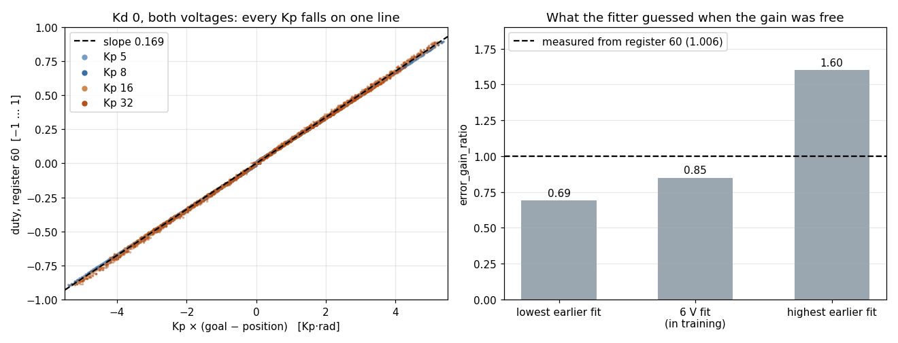
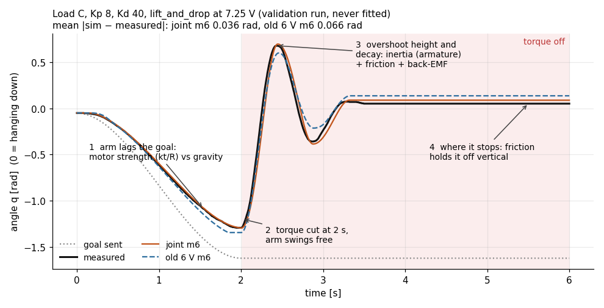
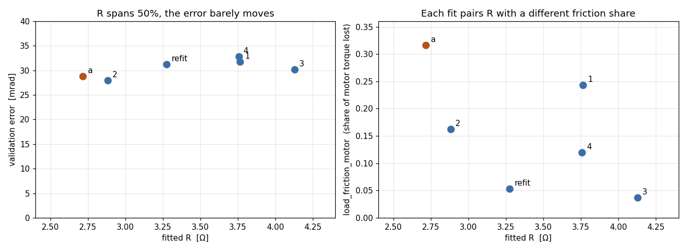

**目标：** 先测量被控对象再做随机化，给每个数字标上来路；只围绕实测值随机化真实存在的不确定性，用能覆盖的分布；并确认策略推断得出它被随机化的那些量。

## 接着上回

第 15 天收尾时，两个引擎彼此一致，台架上的机器人却还在以 7 到 10 Hz 抖。仿真器之间的一致，没能预测台架；改进被控对象，倒是预测了。两个引擎共用一个被控对象，所以错的是它。那么，怎样让仿真里的机器人足够接近真机，剩下的差距再用随机化盖住？

这堵墙比这台机器人老得多。2017 年，OpenAI 的 Josh Tobin 等人用纹理和光照乱七八糟的图片训练了一个物体检测器，它在从没见过的真实相机图像上也能用：真实世界不过是又一种变化。一年后，Xue Bin Peng 等人把同样的思路搬到动力学上，给一个推冰球的机械臂随机质量、摩擦、阻尼和延迟，并给策略配了循环记忆，让它自己判断身处哪台机器人。同一年，Google 的 Jie Tan 等人让 Minitaur 四足机器人从仿真直接走起来，起作用最大的两件事是准确的执行器模型和仿真延迟，随机化是加在上面的。2019 年，Jemin Hwangbo 等人干脆不再手工建模 ANYmal 的串联弹性执行器，而是用记录下来的数据把它学出来。

他们的第一次尝试是最直白的那种：把仿真器做得更准。

## 打个比方

假设你要出国租车，出发前先在模拟器上练车。最直白的办法是做一个完美复刻：就模拟这台车，它的刹车、它的轮胎、那条路。

做不到。你不知道会租到哪台车，刹车会磨损，轮胎上个月刚换过。于是你改成在很多台略有不同的车上练，指望租到的那台就是其中之一。可这只有在练习用的车都围绕着一台像租车的车分布时才管用。围着一台错的车练，租到的那台就成了你经验边缘上的怪车，练再多台也一样。要是因为刹车难建模，干脆在没有刹车的车上练，那你对停车一无所知。

第一个问题出在复刻上：既然完美物理做不到，到底什么必须一致？

## 一步一步来

### 对齐传感器链路，而不是物理

策略从来看不到物理。它看到的是传感器给出的数字，而且是固件滤过之后的；它的动作要经过舵机或电机驱动，驱动拿到指令后怎么动，它说了算。完美物理本来就做不到：摩擦、外壳形变、线缆拖拽，永远对不上。所以“一个忠实的世界”这个最直白的目标，瞄错了。

能对齐的，是策略真正碰得到的那条链路。Microduck 的两张表把两头都写清楚了：

| 链路 | 真机 | 训练里 |
|---|---|---|
| 陀螺仪与重力 | 机身板上的 IMU | MuJoCo 传感器，任意轴 ±6° 安装偏差，噪声（角速度 ±0.03），0 到 1 步延迟 |
| 关节位置 | Dynamixel 磁编码器 | qpos，每个环境启动时抽一次 ±0.86° 的关节零偏，噪声，0 到 1 步延迟 |
| 指令延迟 | USB 到 Dynamixel 总线，约 60 到 120 ms，实测 | 环形缓冲，50 Hz 下 3 到 6 步 |
| 执行器 | XL330 固件 PD，7.4 V 锂电池，带载会掉压 | BAM 模型：固件 PD → 电压（6.5 到 8.2 V，随负载压降）→ 反电动势 → 电流 → 力矩 → 齿轮箱摩擦 |

轮足机器人在这条规矩上又往前走了一步，落脚点就是第 15 天的拆分循环：固件的俯仰和航向滤波器在每个 2 ms 子步上运行，动作延迟也按这个格子来数，所以策略看到的是 ESP32 上的那个信号，而不是一个更干净的版本。

::: field 实战笔记：对齐链路
**什么时候要：** 永远，每个输入、每个输出都要。让观测长得像真传感器（有噪声、有延迟、有偏差、装歪了），让执行器的反应像真的那个（受电压限制、带摩擦、有延迟）。**什么时候不要：** 机器人根本测不到的量。Microduck 没有测机身线速度的传感器，所以它只给评论家看。**会出什么错：** 把固件逐行搬过来的代价，是策略被钉死在那份固件的信号处理和时序上。运行时一换，这笔账怎么算，见第 17 天。
:::

所以目标是链路，而链路是由数字组成的：一个延迟、一个滤波常数、一个力矩常数。数据手册很乐意给你其中一部分。它们对吗？

### 永远要测被控对象：先测执行器

在这个尺寸上，执行器模型是 sim2real 误差最大的来源。仿真里的舵机太强、太快或者摩擦太小，策略就会学出真舵机跟不上的步态。于是腿部舵机 Feetech HD-1910 上了单摆台架：四种负载，一张 Kp × Kd 网格，四条 6 s 的轨迹，单电压 192 条记录，两种电压一共 240 条。BAM（Rhoban 的 Better Actuator Models）仿真器以 5 ms 步长回放每一条记录，CMA-ES 调它的参数，直到回放对上为止。

模型很短。固件把位置误差变成占空比，驱动把占空比变成电压，电机再把电压变成力矩：

$$
\tau_{\text{motor}} = \frac{k_t}{R}\,U \;-\; \frac{k_t^2}{R}\,\omega
$$

::: tip
第一项是推力：电压进，力矩出。第二项是刹车：转动的电机同时也是发电机，它产生的电压和电源对着干。按拟合出的数字，$k_t^2/R = 0.143$ N·m/(rad/s)，大约是机械粘性摩擦（0.016）的九倍。这个舵机的阻尼大部分是电的，没有反电动势的模型，速度和收敛都会错。
:::

最直白的下一步，是让优化器一口气把所有参数都找出来。结果失败得很有教育意义。固件增益和 $k_t/R$ 是相乘的，一个翻倍、另一个减半，力矩不变，分数也不变。在几乎相同的数据上跑两次拟合，得到 $k_t$ = 0.47 和 0.91，电枢惯量差 3.5 倍，误差却几乎一样。

解法是：硬件已经报告了的东西，就别再去拟合。寄存器 60 记录了固件实际输出的占空比，所以在 Kd 为 0 的那些记录上，增益就是一条直线，不用仿真器就能直接读出来：

<figure>
  
  <figcaption>左：37 万个样本、四个 Kp、两种电压，落在一条斜率 0.169 的直线上。右：同一个数放开让拟合器去找时，它给出的结果。图出自我的 HD-1910 标定笔记。</figcaption>
</figure>

把两个固件增益都钉住之后，两次拟合的电枢惯量差在 5% 以内，堵转力矩也和数据手册对上了。评判拟合用的是它没见过的记录：Kp 8 和第四种负载都留作验证。

<figure>
  
  <figcaption>一条拟合从没见过的验证记录。前段的滞后决定 kt/R 对抗重力的程度；断开力矩之后，只剩惯量和摩擦在起作用。这条记录上，双电压联合模型误差 0.036 rad，只在 6 V 下拟合的旧模型 0.066。</figcaption>
</figure>

那个旧模型是另一课。只在一种电压下拟合，到了另一种电压下最多差一倍，因为只有推力随电压变：电机强、摩擦大，和电机弱、摩擦小，在电池电压变化之前看起来一模一样。

::: field 实战笔记：执行器拟合
**什么时候要：** 永远，在任何策略用上这个执行器之前。**怎么做：** 选模型描述得了的控制模式（mode 4，误差直接变 PWM，而不是带隐藏斜坡的 mode 0）；硬件报告的每个数都读出来钉住；把测试设计成每个未知量各留各的指纹（换负载看电枢惯量，断力矩看摩擦，换一个电压分开电机和摩擦）；在机器人会遇到的各种电压下一起拟合。**会出什么错：** 不设种子、多进程并行的 CMA-ES，在一个平坦、带粘滑的分数地形上，每次都落在不同的地方；BAM 还忽略初值，只有边界起作用。**怎么测：** 同一个拟合跑两遍。分数不变而某个数在变，说明数据决定不了它。
:::

钉住之后，还是有一个数定不下来：

<figure>
  
  <figcaption>kt 钉在 0.60 的六次拟合：R 从 2.7 到 4.1 Ω，验证误差几乎不动；电枢惯量六次都在 0.0015 到 0.0019 之间。要定 R，得上一块真电流表。</figcaption>
</figure>

对仿真来说，这没有看上去那么要紧，每次拟合回放的摆臂都在大约 0.02 到 0.04 rad 以内。但舵机是我们主动去查的那一块。裂缝在没人去查的那些地方，因为它们的数字看起来没毛病。

### 给每个数字标上来路

轮足机器人的机身质心就是其中之一。它不是测出来的。固件里有个增益调度常数叫 L_COM，值是 85 mm；仿真反过来解机身连杆的质心，好让整机质心刚好落在 85 mm。解出来的结果，把 185.8 g 的机身放在了它自己外壳顶面上方 25.3 mm 的空中。它在那儿待了十一天。

这个目标从来就够不着。整机 38% 到 44% 的质量在轮轴上，对力矩毫无贡献；机身质量放在机身里任何地方，整机质心都只能在 46 到 75 mm 之间。85 mm 其实是开机高度 `height_ref_mm`：仿真读了这个常数的名字，没读它的用途。一杆厨房秤就能把这种不可能变成读数：两点支撑，按配置的值，一个 185.8 g 的零件得在秤上读出 292.6 g。

这件事要紧，是因为轮式平衡机器人是个倒立摆，摆越长，倒得越慢：

$$
f_n \propto \sqrt{\frac{g}{l}}
$$

::: tip
$l$ 是质心离轮轴的高度。按硬定的 85 mm，被控对象的固有频率是 1.71 Hz；机身质量放回外壳里（58.5 mm），约 2.07 Hz。在慢摆上训练出来的策略，到了真机上反应就晚了。
:::

没有谁粗心。这个值写下时是自洽的，那时机身还是一个 100 mm 的占位盒子；把真实 CAD 机身导进来的那次提交，让它变得不可能，而没有任何东西去比对这两者。“两个数字，两个主人，一条硬性的物理关系，却没有交汇点。”所以解法是一条断言（质心必须在机身盒子里），而不是更小心。替换值来自称重电池和舵机、其余零件按体积加权：7.25 mm，范围在 −2.6 到 +16.9 mm 之间，整机 57.0 mm。

通用的习惯，是给被控对象文件里的每个数字都打上标签。摘自轮足机器人的来路表：

| 标签 | 例子 | 它让你能做什么 |
|---|---|---|
| MEASURED（实测） | 轮半径 19.205 mm；机身、腿、轮质量 185.8 / 40.1 / 32 g；IMU 高度 40 mm | 围绕它窄范围随机化 |
| FROM CAD（来自 CAD） | 连杆长度 52.09 / 52.09 / 12.06 mm；大腿和连杆质量（体积 × 1.2 g/cm³） | 几何可信，质量存疑 |
| FIRMWARE（固件） | 开机高度 85 mm；舵机刻度映射 | 和固件保持同步，绝不当物理量用 |
| CONVENTION（约定） | 闭链刚度，连杆惯量按细杆算 | 知道这是个选择 |
| PLACEHOLDER（占位） | 髋舵机 kp 50；髋部电枢惯量 1e-3 kg·m² | 用实验替换掉之前，别信任何靠它的结果 |

髋部电枢惯量最让人不舒服。它怎么按存活率调出来，第 15 天讲过；这里要说的是，它高于自己的物理估计 3.1 到 6.0e-4，等于把齿轮摩擦折进了惯量。IMU 高度除了第 15 天发现的三份拷贝，还有自己的故事：CAD 和尺子量的都是 ESP32 那块板，不是它上方 20 mm 的 MPU6050。

::: field 实战笔记：来路与门槛测试
**什么时候要：** 被控对象的数字第一次写下时。**会出什么错：** 从别的部件借来的数（固件常数、奖励里的力臂）被当成约束去反解，而不是去测；它能活下来，是因为和它矛盾的那个东西当时还是占位值。**解法：** 一条把物理关系写死的断言。**修好之后门槛测试挂了怎么办：** 质心降低后，机器人在三个开环门槛里倒得更快了。重定基线的办法是把稳定窗口从 0.5 s 缩短到 0.15 s，这正是接触检查声称要测的那一段，绝不是把 2 mm 和 2° 的标准放宽。**还有：** 改一个被控对象数字就是一次时代断点，之前的训练数字从此不可比。
:::

试用期报告把质心修正算作单项最大的修复：修完之后所有结果都变好了。但它解释不了 7 到 10 Hz 的抖动，第 7 拍再回来说。眼下，标签已经干完了它的活：有的数实测了但有离散，有的是占位，有的永远钉不住。剩下的不确定性怎么办？

### 围绕实测值随机化

域随机化（domain randomisation）就是在这里登场的：在很多略有不同的机器人上训练，让真机只是其中又一种变化。最直白的版本是“什么都随机，范围越大越好”。重力、连杆长度、控制频率，全上，变化越多，鲁棒性肯定越好。

并不是。随机化重力，等于教策略应付机器人永远遇不到的物理，代价是在真实的 9.81 m/s² 世界里的表现。Microduck 对关节限位、连杆长度、控制频率和重力一个都不随机：它们要么从 CAD 里精确已知，要么一改就造出机器人根本表现不出来的物理。轮足机器人撞上的是另一种失败。每次台架发现一个差距，就多一个随机化轴，或者把一个轴放宽，直到“这张清单已经不再是鲁棒性工具，而是披着外衣的系统辨识，范围全是猜的”。

所以三条规矩。每个范围以实测值为中心。宽度按真实的不确定性来定。分布要刻意挑，因为分布决定了训练时间花在哪里。这个抽样并不是在模拟各种被控对象出现的概率；它表达的是你对一个固定但未知的值有多不确定。所以要问的是覆盖：

$$
\begin{aligned}
&x \sim \mathcal{U}(a, b) \\
\text{或}\quad &\ln x \sim \mathcal{U}(\ln a, \ln b),\;\; p(x) \propto \frac{1}{x}
\end{aligned}
$$

::: tip
均匀分布在范围里每一处花一样多的训练。对数均匀在每个倍数区间花一样多的训练，所以跨一个数量级的摩擦范围里，好对付的低端和难对付的高端各占一半时间。高斯把大部分训练花在中心附近：中心对的时候很划算，中心偏了，真机就落在一条稀薄的尾巴上。
:::

<dr-grid preset="foot" dist="uniform" real="1"></dr-grid>

试一试。选足底摩擦范围，真机放在实测值上，高斯有 26% 的样本落在真机 ±5% 以内，均匀只有 17%。现在假设测量高估了 20%，把真机拖到 0.80×。均匀还给它 13%，密度和别处一样；高斯掉到 9%，真机处的密度只有实测值处的 0.41。支持高斯的理由是快（“在最可能的值附近多花时间”），那是训练成本的理由，不是鲁棒性的理由。均匀要 3000 次迭代、高斯要 2000 次，那就跑 3000 次。迭代随时可以多买；真实摩擦恰好落在策略几乎没练过的地方，台架上摔的那一跤买不回来。

幻灯片上那句是“让真机成为最可能的那个样本”。和覆盖原则放在一起读，意思是：把范围的中心放在一个好的测量值上，让真机处在这群机器人的中间，而不是边缘。它不是让你把抽样收窄到自己的最佳猜测上。

Microduck 的范围是现成的例子，分两层。启动事件给 4096 个环境各自一个固定的“性格”，整个训练期间不变：机身质心 xy ±25 mm、z ±30 mm，关节零偏 ±0.86°，质量和惯量在对数空间里 ±5%，足底摩擦 0.7× 到 1.3×。重置事件在上面再加每个回合的变化：质心 ±3 mm（课程学习逐步放到 ±15 mm），BAM 摩擦系数和电枢惯量 0.9× 到 1.1×。电压 6.5 到 8.2 V、3 到 6 步的延迟和 IMU 安装偏差则一直开着。在 mjlab 里，这种划分还是机制上的：范围在建环境时烘焙进去，数值每个回合再抽（就是第 15 天那个构建期的坑）。

::: field 实战笔记：用什么分布，多宽
**默认用均匀；尺度类参数用对数均匀**（摩擦、质量比）。❌ 为了提速用高斯。**不要随机化** 重力、连杆长度、关节限位、控制频率。**会移动平衡点的量要逐步放开。** Microduck 上只有质心走课程：质心一动，平衡点本身就变了，会把一个还没学会平衡的策略搞糊涂。“一个会累积的质心随机化器曾经连续几个月拖垮了每一次长训练。”**留意：** 每次台架之后都变长一点的随机化清单。那是范围靠猜的系统辨识；回去测量。
:::

这样一来，抽样有了中心，也覆盖到了。可是抽样能换来鲁棒性，前提是策略在一个回合里分得出自己抽到的是哪台机器人。

### 只随机化推断得出的量，偏差绝不交给随机化

一个被随机化的参数，有两种可能的效果。如果观测里有东西能暴露它，直接暴露也好，几帧之后通过效果暴露也好，策略就能每个回合自适应，这才是真鲁棒。如果什么都暴露不了它，策略就学出一个平均参数，在范围的两头都要付代价，而硬件通常就在那两头。第 13 天在轮足机器人的延迟上把这件事推了一遍：延迟每回合在 5 到 45 ms 之间抽一次，只有把发出的动作和到达的响应对起来才能辨认，而这需要历史。

检验办法就是第 14 天的尾部分箱，这里换成随机化的角度来读。把回合按抽到的延迟分箱，拿延迟最长的那一箱和均值比：

<delay-survival view="seed0" show="both" arm="h1"></delay-survival>

保留了低通的单帧组 h1 和 h1_noreg，在 36-44 ms 分箱上比 control 低了 0.13 到 0.18，远多于它们在总体上的损失。combo 也是单帧，但不滤波，只低了 0.024：一个新鲜样本多少还说了点“现在”，而一帧滤波值几乎全是过去（第 13 天第 3 拍）。从中得出的规矩是：按抽到的值给评估分箱，拿尾部和均值比。差得多，说明策略学的是均值，而不是在自适应。

同样的道理也会让以 0 为中心的抽样失效。Microduck 真机的 IMU 板在俯仰方向装歪了大约 5°。仿真在任意轴上抽最大 ±6° 的安装偏差，而站着不动的机器人分不清是传感器歪了还是机身歪了，于是策略学到平均值，也就是 0。真机却是每个回合都歪 5° 的同一台机器。±6° 训练的是对幅度的容忍，它纠正不了偏差。那一步在运行时标定（`imu-pitch-offset`），不靠训练。

::: field 实战笔记：随机化还是标定
**随机化：** 策略能在线推断出这个值，或者你确实不知道它。**收窄或固定：** 观测里什么都暴露不了它，或者你已经测过了：先标定名义值，再围绕残差随机化。**系统性偏差**（安装偏差、编码器零点）在真机上测。关节零偏是个合规的例外：它在启动时每个环境抽一次然后保持不变，正好对应真舵机在重新校准之前那个固定的偏移。**怎么测：** 尾部分箱对均值。
:::

扯远了，一口气走了五拍，我们先回顾一下。完美物理做不到，所以我们对齐策略碰得到的链路。链路由数字组成，所以要测：执行器靠钉住硬件报告的量再拟合，质心靠称重和一条断言。标签告诉我们哪些数还是猜的。围绕实测的那些，只随机化真实的不确定性，用能覆盖的分布，而且只随机化策略推断得出的量；偏差拿去标定。这一切让训练用的被控对象变得诚实，而诚实就意味着难：PPO 得同时学会行为和鲁棒性。最直白的捷径，是先在一个简单的被控对象上把行为学会。

### 捷径：先在理想化的被控对象上预训练

这就是 sim2sim2real 的思路，第 14 天已经把这个实验和它预先登记的预测走过一遍。这里只关心一点：“理想化”允许去掉什么。

第一组阶梯去掉了所有 sim2real 的轴，还额外去掉了库仑摩擦、粘性阻尼和电池压降。A 阶段的策略从第 200 次迭代起就没在自己的被控对象上摔过。到了诚实的被控对象上，存活率 0.019。光是把名义摩擦、阻尼和压降加回来，干净评估就已经腰斩到 0.42；再加上延迟范围，剩下的也没了。试用期报告给出了实机那边的读法：真实回路有 20 到 40 ms 的延迟，需要预测式的控制律，参考模型教的却是反应式的；没有库仑摩擦，它学到的是推不动真轮子的微小电压。

第二组阶梯保留了名义摩擦、阻尼、压降和一个固定的 12 ms 延迟，只去掉噪声、推力和随机化。这下预训练迁移过去了：从它热启动，诚实被控对象上的训练大约 100 次迭代就到了 control 的平台，而不是大约 700 次，最终存活率一样，横向漂移减半。叠在上面的模仿奖励项没有带来任何可测的好处，所以配方保留两个被控对象，扔掉前向模型。完整报告见[第 14 天的 sim2sim2real 判决](../day14/)。

::: field 实战笔记：支撑用的被控对象
**什么时候用：** 被控对象的认识经常在变、训练要反复重跑的时候。省下的是重跑（15 分钟而不是 5 小时）；第一次跑并不更便宜。**规矩：** 支撑用的被控对象必须保留定义任务的那些动力学。对轮式倒立摆，就是摩擦和真实的动作延迟。**会出什么错：** 人形机器人的瓶颈是发现步态，理想参考可以引导这件事。这里 PPO 从零开始、在全域随机化下大约 700 次迭代就学会平衡，根本没有需要打开的探索瓶颈。**要命的是：** 那个 12 ms 来自硬件日志。方法本身没有告诉我们哪些动力学不能丢，是台架告诉我们的。
:::

还有一个不同性质的保留意见。试用期报告给这个方法引的是 arXiv 2502.15649，判决页面测试的是 arXiv 2606.02636v2。这两个引用我还没对上，暂时当作悬而未决。

所以该在诚实的被控对象上训练，能让它变简单的，只有那些不定义任务的东西。这就剩下每张随机化清单都回避的问题：哪些东西根本不在被控对象里？

### 还没进被控对象的东西

随机化覆盖的是模型里已有的量的不确定性，覆盖不了模型里缺的机制。这个项目上有四样还悬着，在这里也照样悬着。

**柔性。** 质心修正之后，做了一次敲击衰减测试（两个轮子焊死在世界上，敲一下机身），机身摇摆模态从 1.5 Hz 变成 3.1 Hz。台架上的抖动在 7.3 到 9.7 Hz。把髋部电枢惯量扫过整个合理范围，峰值在 3.1、2.6 和 1.5 Hz；舵机刚度从 50 到 200 N·m/rad，每次都是 3.06 Hz；3 到 34 Hz 之间，任何设置下都什么也没有。这个频段是空的，不是没调好。每根连杆都是刚体，齿隙只是一个位置死区，轮胎是个刚性圆柱。唯一的实测数据是机器人在自重下 5 mm 的静态下沉，它意味着有效刚度比模型软大约四十倍，计划把大部分归到四连杆的松旷上。柔性和齿隙都没有建模。第 11 天的 Wobble Chase 从策略那一侧给出了对应的证据：在仿真里看起来很稳的策略做的是微小修正，到了硬件上可能正好被这些效应吞掉。这个解释还没验证。

**俯仰滤波器的滞后。** 固件的俯仰角来自一个互补滤波器，PITCH_TAU = 0.50 s。训练时看到的俯仰是真值加偏移加白噪声，没有滤波动态。第一次上真机的报告把它列为头号遗留差距，而且相位滞后在更高、更敏感的 85 mm 被控对象上伤害最大，这和“40 mm 没事，85 mm 不稳”对得上。把它建模进去，是台架那边提的单项价值最高的改动，至今还没做。

**Microduck 从没仿真过的东西。** 线缆拖拽、XL330 发热后的降额、外壳形变、摩擦系数之外的地面差异。这些只能靠在硬件上测出来。

**落地的域随机化。** 试用期日志第 6 周写着：修复了仿真与固件之间的不一致，让域随机化参数更贴近真实。关于范围是怎么落地的，我手上的描述就这一行；改之前和改之后的范围都不在笔记里。

::: warn
延迟本身也该列在这张单子上。训练范围是按台架上测的固件链路定的（11 到 13 ms，真实被控对象上还有约 20 ms 等效的相位）。可策略一换到另一个运行时，这条链路就变了。
:::

## 常见坑

- **追物理而不是追链路（第 1 拍）。** 仿真里的机器人在查看器里看着很对，策略还是不行，因为它训练时看到的是未滤波的真值，而真机给它的是一个 500 ms 的互补滤波器。
- **把拟合分数当证据（第 2 拍）。** 两次执行器拟合分数一样，$k_t$ 却是 0.47 和 0.91。拟合跑两遍，留出一个增益和一种负载做验证。参数贴着边界，说明真值在边界外面。
- **从别的部件反解出来的被控对象数字（第 3 拍）。** 固件常数、奖励力臂或某个“约定”被当成测量值。症状是一个物理上够不着的值；解法是一条断言。门槛测试挂了，就缩短窗口重定基线，绝不放宽标准。
- **高斯，或者越放越宽的范围（第 4 拍）。** 高斯看起来更快，中心一偏，真机就落在稀薄的尾巴上。每次台架之后都变长的随机化清单，是范围靠猜的系统辨识。
- **随机化推断不出的量，或者一个偏差（第 5 拍）。** 总体存活率几乎不动，尾部分箱却掉了 0.13 到 0.18。围绕一个系统性的 5° 安装偏差做以 0 为中心的抽样，训练出来的是容忍，不是纠正。

<!-- quiz -->

## 下一步

你可能会问：延迟范围是从哪儿来的？从台架来：固件链路实测 11 到 13 ms，每回合 5 到 45 ms 的抽样把它包住，后来为 ESP-DL 移植改成 3 到 30 ms。可是策略一跑到芯片上，延迟就由板子说了算：推理时间、发布延迟、量化。一个在 5-30 ms 上训练的策略，实际跑在 6-9 ms。要让策略跑在芯片上，又不改变它训练时的那个被控对象，需要什么？这就是[第 17 天](../day17/)。

## 参考资料

- `notes/microduck-takeaways.md`（[Notion](https://app.notion.com/p/3dc67249ddbf80a9a46bfe303aab4f37)），“Sim2Real”与“Domain randomization”：感知和执行两张表、BAM 链路、5° 的 IMU 偏差、域随机化的两层、哪些不随机化、质心的课程。
- `notes/design-insights-observations-actions-and-rewards.md`（[Notion](https://app.notion.com/p/3e467249ddbf814ebe4bdb138d4c6b2e)）第 4 节：只随机化推断得出的量，默认均匀，尺度类参数用对数均匀，尾部分箱测试。
- RL Presentation Plan 的第 13 张幻灯片及其问答表（`artifacts/rl-presentation-plan.html`）：sim2real 的四条体会、域随机化范围、遗留差距。
- `artifacts/hd-1910-calibration-layers.html`：HD-1910 单摆台架、mode 4、BAM 模型、反电动势 0.143 对粘性 0.016、增益放开时的陷阱（0.47 对 0.91）、寄存器 60、双电压一课、六次钉住 kt 的拟合。三张图出自它的 `fig/` 文件夹。
- `artifacts/the-floating-centre-of-mass.html`：悬空 25.3 mm 的质心、力矩账本、可达范围 46 到 75 mm、1.71 对 2.07 Hz、厨房秤读数、缩短窗口重定基线、3.1 Hz 的衰减测试和空着的 3 到 34 Hz 频段。
- `artifacts/wlbot-plant-map.html`：来路表（MEASURED、FROM CAD、FIRMWARE、CONVENTION、PLACEHOLDER）、髋部电枢惯量这个占位值、写了三遍的 IMU 高度。
- `artifacts/the-sim2sim2real-verdict.html`：第一组阶梯的 0.019、12 ms 的支撑被控对象、约 100 对约 700 次迭代、“披着外衣的系统辨识”。
- `artifacts/removing-more-made-it-better.html`：延迟图背后的种子 0 阶梯和三种子均值、“这个被控对象参数该不该随机化？”、5-45 到 3-30 ms 的改动。
- `artifacts/manager-based-rl-env.html`（构造时烘焙对每回合抽样）、`artifacts/the-split-loop.html`（500 Hz 的固件滤波器、2 ms 的延迟格子）、`artifacts/yd15-hardware-findings.html`（τ ≈ 500 ms 的俯仰滤波器是头号差距）、`artifacts/constants-ledger.html`（PITCH_TAU 0.50 s）、`artifacts/the-wobble-chase.html`（探针对台架）。
- 试用期报告（[Notion](https://app.notion.com/p/3f367249ddbf80d890eef6f59636b9c5)）3.3 节（未采用的理想参考方案、20 到 40 ms 延迟）、3.5 节（质心修正）、时间线第 6 周；中文报告（[Notion](https://app.notion.com/p/3f467249ddbf8166aff6caa48edf6ffa)）4.1 节。
- J. Tobin, R. Fong, A. Ray, J. Schneider, W. Zaremba, P. Abbeel, "Domain Randomization for Transferring Deep Neural Networks from Simulation to the Real World", IROS 2017（[arXiv:1703.06907](https://arxiv.org/abs/1703.06907)）。
- X. B. Peng, M. Andrychowicz, W. Zaremba, P. Abbeel, "Sim-to-Real Transfer of Robotic Control with Dynamics Randomization", ICRA 2018（[arXiv:1710.06537](https://arxiv.org/abs/1710.06537)）。
- J. Tan, T. Zhang, E. Coumans, A. Iscen, Y. Bai, D. Hafner, S. Bohez, V. Vanhoucke, "Sim-to-Real: Learning Agile Locomotion For Quadruped Robots", RSS 2018（[arXiv:1804.10332](https://arxiv.org/abs/1804.10332)）。
- J. Hwangbo, J. Lee, A. Dosovitskiy, D. Bellicoso, V. Tsounis, V. Koltun, M. Hutter, "Learning agile and dynamic motor skills for legged robots", Science Robotics 2019（[arXiv:1901.08652](https://arxiv.org/abs/1901.08652)）。
