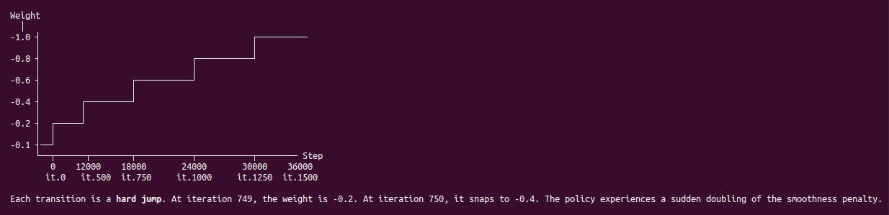

**目标：** 为一个装着好几种技能的策略设计课程和命令分布，从曲线上读出每个阶段来得是早是晚，并把任何新技能都写成同一个强化学习问题，只是把五个槽位重新填一遍。

## 接着上回

第 18 天停在一台机器人、一个技能上：平衡，并保持航向。就这样，sk_lean4 还发现光站稳、不管航向，每步也能拿 0.65。一个会走、会站、会转头、后来还要滑轮滑的双足机器人，需要一个策略里装好几种行为；如果简单的那个先给了回报，难的那个就永远学不会。课程该按什么顺序排？

给网络排课，这事有人做了很久。1993 年，Jeffrey Elman 用带嵌套从句的句子训练一个循环网络，全量数据一起上，学不会；先从简单句子开始，或者先给一个短的、慢慢变长的记忆，才学会了。论文标题就叫“从小处开始的重要性”。2009 年，Yoshua Bengio 等人给这个想法起了名字：课程学习（curriculum learning），并在形状识别和语言模型上展示了它能加快训练。到了足式机器人，2021 年 Nikita Rudin 等人在仿真里同时训练几千台 ANYmal，用的是游戏式的地形课程：走得够远的机器人被挪到更难的地面上，失败的被挪回去。

这些都拦不住人从同一个地方起步。我给同事讲的那页幻灯片说得很直白：“如果一开始任务就太难，机器人永远拿不到能学的奖励。”他们的第一次尝试是最直白的那种，我的也是：从第零步就把完整的任务扔给机器人。

## 打个比方

教人骑自行车，最直白的办法是每节课什么都练：蹬车、拐弯、刹车，还有定车，也就是停着不动保持平衡。每样练得一样多，从第一天开始。

它会以一种很具体的方式出错。定车看起来最简单，于是学的人两只脚踩着地“练”定车，因为没摔倒而受表扬，却永远没练出那个让平衡变容易的速度。骑行才是难的技能，早期几乎所有的练习都该给它。简单的部分先给了回报，难的部分就没有东西可学。放到机器人上，最先冒出这个问题的地方，是一个策略暂时还跟不上的命令。

## 一步一步来

### 命令就是难度旋钮

Microduck 是一台 25 cm 高的双足机器人，14 个舵机，在 mjlab 里训练：每次迭代 4096 个环境 × 24 步，一共 50,000 次迭代。它的策略吃三种命令，各自按自己的计时器重新采样：一个速度命令（twist：前后 ±0.4 m/s，左右 ±0.3 m/s，转向 ±1.0 rad/s），一个管四个颈部和头部关节的头部姿态，一个身体姿态。头占了整机质量的 38%。

最直白的做法，是从第一次迭代起每个命令都在全量程里采。可策略连路都走不稳的时候，你让它把头转到 ±1.1 rad（大约 63°），等于让它在还不会平衡时就甩动 38% 的身体质量。笔记里的说法是：头部命令于是成了噪声，头部命令槽位后面的权重永远长不起来。

对笔记给的这个理由，我不完全信。头部跟踪是一个高斯奖励：

$$
r_{\text{head}} = \exp\!\left(-\frac{e^2}{2\sigma^2}\right), \qquad \sigma = 0.5
$$

::: tip
$e$ 是头部的跟踪误差，单位 rad。头不理 0.05 rad 的命令，照样拿 $e^{-0.005} = 0.995$；不理 1.1 rad 的命令，拿 0.089。1.1 rad 处这条钟形曲线并不平，所以梯度并不是真的“看不见”。我更愿意押的是另一种解释，没测过：一个大的头部命令会把还不会走的机器人掀翻，回合结束，跟踪项不管想说什么，都没剩多少回合让它说了。
:::

不管哪种解释，修法都一样。头部范围从 ±0.05 rad（大约 3°）起步，小到笨手笨脚的策略也能大致满足，然后随着步态成形慢慢放宽：第 500 次迭代 ±0.17，第 1000 次 ±0.39，第 1500 次 ±0.72，第 2000 次 ±1.1。这样策略是在拉伸一个已有的技能，而不是从零去发现一个。身体姿态跟踪在这个环境里是关掉的（权重 0），可它的范围仍然放在 ±0.005 而不是正好为零，让这些输入一直在变。一个从来不变的输入会怎样，第 13 天讲过：在轮滑机器人上，一个 3° 的头部命令掀翻了 98% 的机器人。

随机化也是一种难度，待遇一样，但只用在会改变任务本身的地方。躯干质心从 ±3 mm 开始随机，到第 1500 次迭代放宽到 ±15 mm，因为挪动质心会挪动策略还在找的那个平衡点。其余的从第零步起就固定：电池 6.5 到 8.2 V，动作延迟 3 到 6 步，编码器偏置 ±0.86°，IMU 安装偏差 ±6°，质量和惯量 ±5%，关节摩擦 ±10%。这些都还温和，不至于毁掉早期学习。哪些维度该上斜坡，是靠经验摸出来的，不是靠公式。

::: field 实战笔记：命令和域随机化都是难度旋钮
**什么时候要：** 一个命令或一项随机化会改变“平衡”是什么意思的时候（头部姿态，而头占 38% 的质量；质心偏移）。**什么时候不要：** 范围温和到早期策略扛得住；Microduck 有六个随机化维度从第零步就固定。**会出什么错：** 一个你没排进课程的难度。轮滑的 cfg 特意把自己的质心随机化封顶在 10 mm，可它继承的 mjlab 基础模板自带一个启动时的质心偏移，横向 ±25 mm、竖直 ±30 mm，轮滑从没把它删掉。那个事件到底移动哪些刚体没查过，所以它实际有多大还没确认。**怎么测：** 列出*构建好的*环境里的事件，而不只是你自己 cfg 文件里加的。⚖️ 模板的事件会跟着模板一起来。
:::

于是每个命令都学得会了。但旋钮只管每节课有多难，不管练习时间给谁。站立也是一个命令，就是那个零命令，而且它是机器人能做的最简单的事。

### 先练难的，并把课程压在前面

Microduck 的策略在命令为零时必须站定，所以一部分环境得被命令站着。最直白的比例就是最终的那个：从一开始就 25% 站立。

可站立几乎不要钱。机器人从 HOME 姿态出生，什么都不做就能拿到大部分姿态和直立奖励。四分之一的批次在为“输出全零”付钱，网络在任何步态出现之前就能满足这一块，它会死死抓住。走路才是难的：左右腿交替、单腿支撑、抬脚间隙，全靠几千次失败去找。PPO 学的是同策略数据，它只能改进策略眼下正在尝试的东西。所以 Microduck 从 98% 走路、2% 站立开始，2% 只是为了别忘了，然后往回补：第 500 次迭代 5%，750 次 10%，1000 次 15%，1500 次 20%，2000 次 25%。

平滑惩罚是同一课，换到奖励这边。`action_rate_l2` 从 −0.1 开始，到 −1.0 结束，因为在机器人会走之前就为抖动收钱，什么都不做就成了最便宜的策略。轮滑机器人从第一次迭代就用 −1.0；后果在第 6 天（动作 std 在 100 次迭代内从 1.0 掉到 0.3，滑行一次都没出现过）。头部下垂惩罚等得更久：大约第 600 次迭代之前是关的，然后 1.0、2.0，到第 1500 次是 3.0，因为修正低头是打磨，不是技能。

而且这一切都结束得很早。到第 2000 次迭代，每条轨道都到了最终值，那是 50,000 次里的 4% 左右。课程唯一的任务，是把策略送过早期那段难熬的探索；剩下 96% 都是在满难度下巩固，因为一个任务到第 30,000 次迭代还在变的策略，永远定不下来。

剩下一个问题：“第 2000 次迭代”到底指什么。Microduck 的每个阶段都按 env step 计，按每个环境来数：

$$
\text{env steps} = k \times N_{\text{steps}}, \qquad N_{\text{steps}} = 24
$$

::: tip
$k$ 是迭代次数。12,000 env step 的那个阶段落在第 500 次迭代，因为每次迭代每个环境采 24 步。把 rollout 加倍到 48，同一个阶段就落在第 250 次：每个环境的经验一样多，梯度更新却只有一半。
:::

另一半教训，是轮足机器人吃了亏才学到的。它的 CPU 配置写着“推力在 250 万个环境步里爬满”，在 8 个环境 × 2048 步的 rollout 下，那是 153 次 PPO 更新。原样搬到 4096 个环境 × 24 步，就只剩 25 次，策略还没学会平衡就挨了满力的推：回合长度涨到 55，又掉回 41。现在它的 `RampCurriculum` 把推力上限和初始倾角按整个 run 的一个比例从零爬满（`warmup_fraction: 0.5`），环境数和 rollout 长度怎么改都不受影响。按每环境步数计，扛得住前一种改动，扛不住后一种；按比例计，两种都扛得住，但 run 的长度一变它就跟着挪。哪个时钟一般来说才对，我不知道。优化器数的是更新次数，策略数的是经验，两份笔记各选了一个。

::: field 实战笔记：预算和时钟
**什么时候要：** 一个策略里有一个简单技能和一个难技能。早期经验几乎全给难的（98% 走路），简单的往后补。**会出什么错：** 从第零步就满额的惩罚，也是一笔探索税（轮滑的 std 塌缩）。斜坡挂在一个含义变了的计数器上：轮足机器人的斜坡 25 次更新就走完了。第 10 天还有另一个版本：配置在 import 时就被冻住，一个本该在训练 50% 处结束的斜坡，在 9.4% 处就结束了。**怎么测：** 把课程的值本身记进日志（`Curriculum/*`），核对每个阶段实际在哪次迭代触发，和你想要的是否一致。✅ 压在前面：50,000 次里，2000 次之前全部完成。
:::

于是策略先学会走，后学会站。现在一个网络得两样都会，而教其中一样的奖励，和教另一样的在打架。

### 按命令给奖励加门控

走路需要腿离开 HOME。紧的姿态奖励说“待在 HOME”，速度奖励说“动起来”。不加条件地把它们加在一起，每一步都是两项反方向拉扯出来的妥协。

最直白的修法是一个状态机：一个站立控制器、一个行走控制器、一个开关。Microduck 的另一条路第 12 天已经讲过：一个网络，开关放进奖励里，脚部那几项（腾空时间、抬脚间隙、摆动高度）只在命令高于 0.01 时才付钱。同一个门控的另一半是姿态项，它的容差跟着命令变：

$$
\begin{aligned}
r_t &= \sum_i w_i\, g_i(c_t)\, r_i(s_t, a_t) \\
g_{\text{foot}}(c) &= \mathbb{1}\!\left[\,\lVert v^{\text{cmd}}_{xy}\rVert + \lvert \omega^{\text{cmd}}_z\rvert > 0.01\,\right]
\end{aligned}
$$

::: tip
$g_i$ 只取 0 或 1，在求和之前根据命令 $c_t$ 算出来。命令为零时，脚部项关掉，姿态收紧，机器人站着才有钱拿；命令一来，步态项打开，姿态放松。两种模式，不再抢同一个 std。
:::

门控要起作用，命令空间的每一块都得在批次里出现。各个速度从均匀分布里独立采样，“原地转圈”需要两个线速度同时接近零，笔记估计这种情况只占 2% 左右，不够学会转圈。所以 4096 个环境被分成几个桶：2% 正好为零的站立（就是那个后来涨到 25% 的份额），20% 只有前后和转向，15% 原地转圈，其余完全随机。计时器也错开：速度命令每 3 到 8 秒换一次，头部姿态每 2 到 5 秒换一次，这样策略见过“头在动，脚接着走”，而不只是“所有东西一起变”。在行走这个范围里，一个策略覆盖整个命令空间，混合发生在网络内部：(0.3, 0, 0.5) 就成了一条弯着走的路线。不能混合的技能各有自己的策略：走路和前滚翻是两个独立的 ONNX 文件，因为没人想要 50% 的前滚翻。

轮滑机器人是第 12 天的反例：奖励乘上了命令却不看误差，学出来的是一个开关；“滑行”停下来的方式和“刹车”一模一样。一个命令要有意义，得有某个奖励能把它和别的命令分开。

::: field 实战笔记：按命令加门控的奖励
**什么时候要：** 一个策略里的几种模式想要相反的东西（站和走）。按命令给各项加门控；换一个 std，别用一个 std 硬扛。**什么时候不要：** 绝不能混合的行为（走路和翻滚）各用各的策略。**会出什么错：** 一个命令的奖励分不出它和邻居的区别；命令是“站”的时候步态时钟还在走（Jumper 的修法：清零）。**怎么测：** 在几个固定命令下跑 rollout，量机器人到底在干什么。轮滑的 `Metrics/twist/error_vel_xy` 整个 run 都是 0，因为它的指标函数是空的，只有 rollout 才看出了那个开关。
:::

于是一个网络能走、能站、能四处张望，而前 2000 次迭代里，它脚下有六条进度表在动，有的边界上一次动四条。怎么知道一个阶段来得是不是时候？

### 读边界：阶梯还是斜坡

Microduck 的阶段是硬跳，不是斜坡。第 749 次迭代，动作变化率权重是 −0.2；第 750 次，变成 −0.4。策略在一个 tick 里感到平滑惩罚翻了一倍，第 500 次也翻过一次。

*我自己画的阶梯。终端渲染把跳变的标签放得稍有错位；以下面组件里的进度表为准。*

曲线在边界上往下掉，最直白的读法是有东西坏了。第 10 天的 Run Doctor 就在这次训练上把这个读法拆过了：每次跳变都是故意让曲线掉一下，健康的边界 100 到 200 次迭代内回来，掉下去不回来是来得太早，完全不掉是本可以早点来。这里把同样的读法，变成一个关于进度表的问题。

<curriculum-timeline mode="stair" it="750"></curriculum-timeline>

挨个点这几个边界，读数就是第 10 天那些。200 次迭代后还低于跳之前水平的是 1000、1500 和 2000 这三个，三个都放宽了头部范围。可 500 也放宽了，它恢复了，所以我没法把账算到头上。惩罚加重本来就会压低总奖励，单看总奖励曲线定不下来：Run Doctor 的规则是先看被冲击那一项背后的原始 `Metrics/*` 再下结论，而这三个边界的那一步，我的笔记里没有。它们仍然是悬案。

现在把开关拨到斜坡。同样的目标摊到几百次迭代里，每次迭代最大的变化从 ×2 掉到远低于 1%。这对策略温柔得多，轮足机器人的 `RampCurriculum` 就是这么做的。但它也拿走了边界：没有一个时刻可以开始往下掉，“掉下去再回来”的读法没有地方发生；一个来得太早的阶段，只会变成一段说不清从哪天开始的缓慢下沉。阶梯是你自己排进日程的一场测验。Microduck 从没跑过斜坡版本，所以我没有它的曲线，只有这笔交易。

掉一下，也是一只告诉你阶段该什么时候来的钟，轮滑机器人在这上面错了两次（第 12 天）：第 250 和 500 次的动作变化率加重，砸在还在成形的滑行上；第 750 次加的轴承阻力，正赶上轮子转速到顶。

::: field 实战笔记：读一个边界
**健康、太激进、太保守：** 第 10 天那三种读法。**难度要等它威胁的那个技能稳了再加**（轮滑的轴承阻力：750 ❌，2000 ✅）。**要和排好的掉落分开的失败特征：** 总奖励在涨、跟踪项不动（正则项变便宜了，机器人又静又顺，就是不走）；奖励在涨、`fell_over` 也在涨（一个高回报、以摔倒收场的瞬态）；`mean_std` 在几百次迭代内跌破 0.1（探索停了）。**会出什么错：** 挂在总奖励上的终止规则，会在一次排好的掉落上触发（第 14 天，sk_lean5_s0）。
:::

机关不少，扯远了，我们先回顾一下。命令成了难度旋钮，每个都从小到学得会的地方开始。经验预算先给难的技能，整个课程在前 4% 里就跑完。按命令给奖励加门控，让一个网络不用状态机就能走能站；命令分桶保证命令空间的每一块都有数据。阶梯让每个阶段都成了一场排好的测验，看它掉下去之后回不回来。可这一切都默认了一件事：技能是带点花样的速度跟踪。跳一下、跳支舞、鞠个躬，根本没有速度命令可以排课。

### 走路之外：同样五个槽位，重新填

碰到新技能，最直白的做法是换一套新框架。我那份 Jumper 实战指南的要点是：不用换。一个行走任务有五个槽位，其他每个技能都只是把它们重新填一遍：

| 槽位 | 走路 | 其他技能 |
|---|---|---|
| 目标 | 目标速度 | 一段录像、一个姿态、一串按时间排的姿态，或者什么都没有 |
| 观测 | 传感器、关节角、上一步动作、目标 | 再加一个时钟，或者录像接下来几帧 |
| 奖励 | 和目标吻合程度的钟形打分 | 和录像有多接近，或者一个量出来的结果，比如高度 |
| 回合开始 | 站着 | 录像里的随机位置、半空中，或者上一个技能结束的地方 |
| 回合结束 | 摔倒或超时 | 偏离录像，或者落地 |

有两条规则对每个技能都成立：训练时评论家（critic）可以看真实速度和足底接触，而演员（actor）只看真实传感器（第 13 天）；训练之前先算一个一动不动的机器人能拿多少分（Jumper 上是行走奖励的 52%，第 12 天）。然后，关于这个技能的三个问题，会把你带到四种配方中的一种。

<recipe-tree></recipe-tree>

指南里原本那个组件只是个占位符，所以这三个问题是我从它“什么时候用”那一栏读出来的。花哨的技能最常落到的是最后一种配方，而它就是今天这一课换了个样子。照抄片段，上限就是片段：Jumper 的模仿跳跃跳到 0.159 m，片段本身是 0.162 m。只为高度付钱，又什么都发现不了。于是把片段同时喂进动作和奖励，随着高度奖励接手把它淡出：第 1,000 次迭代之前满额，到第 3,000 次归零。指南只给了这两个点；如果中间是线性的，那就是

$$
\alpha(k) = \operatorname{clip}\!\left(\frac{3000 - k}{2000},\; 0,\; 1\right)
$$

::: tip
$\alpha$ 是第 $k$ 次迭代时片段还在多大程度上引导动作：1,000 之前是 1，2,000 时是 0.5，3,000 起是 0。中间那条直线是我猜的，指南只说了满额和归零。这是给“帮助”排的课，而不是给任务排的课：辅助轮按时间表拆掉；beak-throw 则留了 0.1 的下限，没有拆干净。
:::

片段必须引导动作，不能只进奖励；只放进奖励，Jumper 学出来的是一个下蹲。凡是要卡节拍的动作，节拍也别让网络自己数。第 13 天讲过那支跳着跳着漂到 126 BPM（目标 100）的舞：让脚本或控制器去数 50 Hz 循环的 tick（第 250 个 tick 就是 5 秒），把当前目标写进输入，就像卡拉 OK 屏幕把下一个字点亮。

::: field 实战笔记：新技能
**会撤走的帮助：** 回合从动作中途开始，或者加一个辅助，一旦 60% 的尝试成功就撤走。✅ 和先抄再淡出是同一个想法。**结果奖励：** 每个数都有作弊办法；只为刷新本回合最好成绩付钱。**会出什么错：** 录像和仿真器对不上（先不带策略回放一遍：关节顺序、限位、地面高度）；一个设置被解析了却从没生效（一个权重为 0 的后空翻辅助，连着两个版本都被跳过）。**悬而未决：** Jumper 的姿态策略已经能跟踪 twist、俯仰、横滚和高度，所以一条命令时间线本可以驱动它。还没有人试过。
:::

于是任何技能都是同一个问题，槽位重新填过。其中一些能在一个网络里混合，一些不能，这给机器人留下两个问题：此刻跑哪个策略？每个策略又该发布哪个检查点？

### 一台机器人上的几种技能，以及发布哪个检查点

第一个问题，最直白的答案是一个包揽一切的大策略。在行走范围内，Microduck 就是这么做的，而且划算：头猛地一偏时，髋部挪一下让质心留在脚上方，这个没人编过程序，是那一个网络自己找到的。一个走路模型加一个头部模型五五开地混合，谁也不知道对方对平衡的影响。可翻滚和走路混不了，所以跨技能的答案是一个技能一个策略，机器人上放一张小规则表：状态不安全就进安全模式，按了按钮就进对应技能，否则就走。交接由控制器收拾干净：先把关节缓缓送到下一个技能的起始姿态；录好的动作，时钟从进入那一刻开始走；手势以站立姿态收尾，这样回到走路这一步就在数据里。在 Jumper 上，“一句话变成一个动作”靠的是一个照着写好的剧本工作的 AI 智能体，有测试，有一张固定的控制名单。没有什么文字生成动作的模型。

第二个问题，最直白的答案是最后一个检查点。它不一定最好：指南里提到的一个仓库，成功率到最后一个检查点从 100% 掉到了 8%。用一套固定的测试集挑检查点，看摔倒率和视频；回放时把课程拨到那个检查点的迭代（第 10 天）。Microduck 笔记里的经验是：一个 50,000 次迭代、到第 5,000 次就进入平台的 run，第 10,000 次以后的检查点大概都差不多；轮滑在 5,000 到 7,500 次进入平台，更晚的检查点跑的是同一种蹬法，只是摔得少些。

::: field 实战笔记：那一条规矩
“你设的每个数旁边，写下为什么，以及你量到了什么。”这一页上每个数，在我的笔记里旁边都写着理由，所以那些没写的（三个没恢复的边界、淡出的形状、该用哪个时钟）一眼就能找出来。
:::

指南最后给了一张在 Microduck 上按顺序做的项目阶梯：

| 步 | 项目 | 配方 |
|---|---|---|
| 1 | 边走边侧倾、下蹲或四处张望 | 行走 + 一个命令 |
| 2 | 一段由脚本播放的头部和身体小舞蹈 | 命令时间线 |
| 3 | 一个固定的步伐节奏，叫停就站住 | 行走 + 一个时钟 |
| 4 | 照三四个关键姿态做一个点头或挥手 | 照抄录像 |
| 5 | 照一条手搓轨迹跳一小下 | 先抄，再淡出 |
| 6 | 能跳多高跳多高 | 奖励结果，只为新纪录付钱 |
| 7 | 用手柄在技能之间切换 | 一个模式一个策略 |
| 8 | 剧本和测试，让智能体能自己添技能 | 智能体工作流 |

每一级都是同样五个槽位，用 PPO 训练，在一个仿真器里，面对一个不会还手的世界。

## 常见坑

- **从第零步就给满量程（第 1 拍）。** 一个策略暂时跟不上的头部命令，或者一个永远正好为零的槽位。症状是范围放宽之后跟踪项还是一动不动；在轮滑上，则是后来一个 3° 的命令掀翻 98% 的机器人。
- **预算给了简单的技能，或者税先到了（第 2 拍）。** 从第一次迭代起就 25% 站立，或者 −1.0 的动作变化率。症状是 `mean_std` 在几百次迭代内塌下去，机器人站得漂漂亮亮，就是不走。
- **时钟换了含义（第 2 拍）。** 一个按总样本数计的课程，搬到更多环境上，25 次更新就走完了；回合长度涨上去又掉回来（55 → 41）。核对每个阶段实际在哪儿触发。
- **把一次掉落当成失败，或者把卡住不动的掉落当成噪声（第 4 拍）。** 惩罚加重时总奖励本来就该降。看这个阶段 100 到 200 次迭代内回不回来；总奖励说不清时看原始指标；终止规则永远别挂在总奖励上。
- **发布最后一个检查点（第 6 拍）。** 一个仓库里从 100% 掉到 8%。用固定测试集和视频来挑。

<!-- quiz -->

## 下一步

这一页上的每个技能，都是同样五个槽位重新填过，在仿真器里用 PPO 训练出来的：一台机器人，一份人写的奖励，一个不想赢你的世界。你可能会问：这个框框外面是什么？一个也在学、会反过来对付你的智能体，比如自我对弈（self-play）；一个机器人可以在里面做规划的世界模型；一次采好、离线学习的数据；把语言当成目标。这就是选修课，还没写好：先是多智能体与自我对弈，然后是一张前沿地图。在它们出现之前，往前走的路先通回[课程总览](../)。

## 参考资料

- `notes/microduck-takeaways.md`（[Notion](https://app.notion.com/p/3dc67249ddbf80a9a46bfe303aab4f37)）：“Learning curriculum”（六条轨道、压在前面、env step、先练难的、只有质心上了课程）、“Rewards being conditional”、“Command staggering and distribution”、“Training introspection”（边界、失败特征、`mean_std`）、“Checkpoint selection”。
- `artifacts/rl-presentation-plan.html`：第 12 页幻灯片及其课程时间线表。
- `artifacts/microduck-run-doctor.html`：组件里那条真实奖励曲线和六个边界读数，知道课程安排的预期模型。嵌入在[第 10 天](../day10/)。
- `artifacts/jumper-field-guide.html`（“走路之外”的主要来源）：五个槽位、四种配方、谁来打拍子、陷阱表、机器人上跑几种技能、Microduck 项目阶梯。
- `artifacts/roller-model-inquisition.html`：继承来的 ±25 mm 质心事件、第 250 和 500 次迭代的动作变化率加重、750 和 2000 处的轴承阻力、开关式的策略、滑行等于刹车、空的指标函数。
- `artifacts/wlbot-learning-log-aug-30.html`（Session 3）和 `notes/ppo-takeaways-clean.md`：`RampCurriculum`、`warmup_fraction: 0.5`、25 次更新就走完的斜坡。
- `images/microduck-takeaways/01.png`：我画的阶梯图。
- J. L. Elman, "Learning and development in neural networks: the importance of starting small", Cognition 48, 1993.
- Y. Bengio, J. Louradour, R. Collobert and J. Weston, "Curriculum Learning", ICML 2009.
- N. Rudin, D. Hoeller, P. Reist and M. Hutter, "Learning to Walk in Minutes Using Massively Parallel Deep Reinforcement Learning", CoRL 2021（[arXiv:2109.11978](https://arxiv.org/abs/2109.11978)）。
